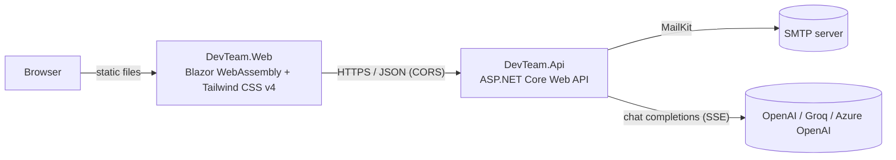

# DevTeamPortfolio

The website of **DevTeam AI**, an AI development studio in Stockholm run by its founder and Lead AI & Solutions Engineer **Adel Kobansson**. The offer is: you describe your idea – we build and deliver your application from the ground up with modern .NET and AI. Visitors start with the **AI App Builder**, meet the founder and contact Adel through a form that forwards messages by e-mail.

Built end-to-end on **Modern .NET** (currently targeting .NET 10): an ASP.NET Core Web API backend and a Blazor WebAssembly frontend styled with Tailwind CSS. Public texts deliberately avoid version numbers ("Modern .NET", "Enterprise .NET", "Cloud-Native").

---

## Features

- **Dark glassmorphism UI** – zinc/slate background with soft neon gradients (cyan, purple, blue, green), translucent `backdrop-blur` cards and a cyan→purple border-gradient with dual glow, lift and a cursor-following light on hover (profile cards, project cards, contact cards and the AI panel). Content fades in as you scroll (`data-reveal`, an `IntersectionObserver` in `wwwroot/js/ui.js`). Hover effects only apply on devices with a mouse, and all animations respect `prefers-reduced-motion`.
- **System status bar** – a hero module with live status dots fed by `GET /api/status`: *API Online* (the API answered), *Azure Live* (the API runs on Azure – detected through App Service / Container Apps environment variables, otherwise "Local environment") and *AI Model Active* (an AI provider is configured, otherwise "AI Model Standby"). It refreshes every 60 seconds and shows red/grey states if the API is unreachable.
- **Responsive** – tighter paddings and section spacing on phones, 16 px inputs in the AI widget (no iOS zoom), safe-area aware floating button.
- **Developer profiles** – skills grouped by frontend (cyan), backend (purple), cloud/DevOps (blue) and quality/ways of working (green), each with a colour-coded glow, served from the API.
- **Product showcase** – a featured full-width card for **DevTeam AI AppBuilder**, the studio's own AI-driven architecture and prototype engine, with a CTA into the builder. Tech-stack chips and a vector cover when there is no screenshot.
- **Contact section** – Adel's direct-contact card (data comes from the API): `mailto:` link, a "Copy Email" button with instant "Copied!" feedback, a `tel:` phone link, and LinkedIn / GitHub buttons. Empty fields are hidden. Below it, a validated contact form protected by rate limiting and delivered over SMTP.
- **Swedish & English** – full i18n via `IStringLocalizer` (`Resources/Strings.resx` = Swedish, `Strings.en.resx` = English). An **SV | EN** switcher in the header stores the choice in `localStorage` (`devteam.culture`); first-time visitors get Swedish if their browser is Swedish, otherwise English. The API returns bios and project descriptions in the requested language.
- **DevTeam AI assistant** – a glassmorphic widget in the bottom-right corner with two tabs: a **chat** (streamed answers, quick-question chips) that answers from the site's own content (RAG), and a **job-ad matcher** that scores how well Adel fits a pasted role description (0–100 %, key strengths, gaps, reasoning). Works in Swedish and English. See [DevTeam AI](#devteam-ai).
- **AI App Builder (blueprint generator)** – "From app idea to prototype in 10 seconds": a visitor describes an app (or picks *Booking app*, *SaaS platform*, *E-commerce*) and gets a structured blueprint in four interactive tabs: **Overview & Quote** (summary, user stories, delivery-phase timeline with an indicative total – no prices), **Database & Architecture** (architecture strip, clickable entities with fields and relations, generated PostgreSQL `CREATE TABLE`), **Prototype sketch** (clickable wireframes of the main views) and **Contact Adel** (the finished brief is pre-filled into the contact form, copied, or mailed to Adel). See [AI App Builder](#ai-app-builder).
- **Resilient UX** – loading skeletons and friendly error states.
- **Deployment ready** – multi-stage Dockerfile for the API and a GitHub Actions pipeline targeting Azure.

## Architecture



| Area | Technology |
| --- | --- |
| Runtime / SDK | .NET 10 |
| Backend | ASP.NET Core Web API (controllers), `Microsoft.AspNetCore.RateLimiting`, DataAnnotations validation |
| Frontend | Blazor WebAssembly (standalone), Tailwind CSS v4 (CLI, built by MSBuild) |
| E-mail | [MailKit](https://github.com/jstedfast/MailKit) over SMTP (STARTTLS / implicit TLS) |
| Containers | Multi-stage Dockerfile (`sdk:10.0` → `aspnet:10.0`, non-root) |
| CI/CD | GitHub Actions → Azure App Service (API) and Azure Static Web Apps (web) |

### Key design points

- **Rate limiting** – `POST /api/contact` uses a per-IP sliding-window limiter (default **3 requests / minute**). Excess requests receive `429 Too Many Requests` with a `Retry-After` header. CORS runs before the limiter so browsers can read the 429 response.
- **CORS** – only the origins listed in `Cors:AllowedOrigins` may call the API.
- **E-mail abstraction** – the controller depends on `IContactEmailSender`. `Smtp` sends real e-mail (the visitor's address is set as *Reply-To*, header values are sanitised); `Log` (default) sends nothing, which keeps local development friction-free. Other providers, such as Azure Communication Services, can be added by implementing the interface.
- **Tailwind in the .NET build** – `DevTeam.Web.csproj` runs the Tailwind CLI before every build, so no separate CSS step is needed.

### API

| Method | Route | Description |
| --- | --- | --- |
| `GET` | `/api/profiles?lang=sv\|en` | The two developer profiles (bio in the requested language, default `sv`) |
| `GET` | `/api/projects?lang=sv\|en` | Joint portfolio projects (description in the requested language, default `sv`) |
| `GET` | `/api/status` | `{ api, azure, ai }` booleans for the hero status bar (no secrets or provider details) |
| `POST` | `/api/contact` | Submit a contact message (`name`, `email`, `message`). Returns `202`, `400` (validation), `429` (rate limited) or `500` (delivery failed) |
| `POST` | `/api/ai/chat` | Ask a question (`message`, optional `history`, `language`). Streams the answer as Server-Sent Events. Returns `200`, `400`, `429`, `502`/`503` (provider error / AI disabled) |
| `POST` | `/api/ai/match-job` | Analyse a job ad (`jobDescription` 40–6000 chars, `language`). Returns `{ score, strengths, gaps, reasoning }`. Same status codes as chat |
| `POST` | `/api/ai/generate-spec` | Turn an app idea (`idea` 10–1500 chars, `language`) into a blueprint: `{ title, tagline, summary, userStories, techStack, entities, uiComponents, estimatedTimeline, previewHtml }`. Returns `200`, `400`, `422` (not an app idea), `429`, `502`/`503` |
| `POST` | `/api/ai/update-preview` | Revise an existing prototype (`html` 20–48 000 chars, `instruction` 3–400 chars, `language`) and return `{ previewHtml }`. Same rate limit. Returns `200`, `400`, `429`, `502`/`503` |

## Repository structure

```
DevTeamPortfolio/
├── .github/workflows/deploy.yml   # CI/CD pipeline
├── DevTeamPortfolio.sln
├── DevTeam.Api/                   # ASP.NET Core Web API
│   ├── Controllers/               # Profiles, Projects, Contact, Ai
│   ├── Models/                    # DeveloperProfile, Project, ContactMessage, AI DTOs
│   ├── Services/Email/            # IContactEmailSender, SMTP + logging implementations
│   ├── Services/Ai/               # IAiService, chat-completions client, RAG, assistant
│   ├── Services/Portfolio/        # PortfolioContent (single content source)
│   ├── Dockerfile
│   └── Program.cs                 # CORS, rate limiting, e-mail registration
└── DevTeam.Web/                   # Blazor WebAssembly
    ├── Components/                # ProfileCard, ProjectList, ContactForm, SkillGroup, AiAssistantWidget
    ├── Services/AiClient.cs       # SSE streaming client for the AI endpoints
    ├── Pages/Home.razor           # Hero → Profiles → Projects → Contact → Footer
    ├── Styles/tailwind.css        # Tailwind v4 entry point
    └── wwwroot/appsettings.json   # ApiBaseUrl
```

## Running locally

### Prerequisites

- [.NET 10 SDK](https://dotnet.microsoft.com/download/dotnet/10.0)
- [Node.js](https://nodejs.org/) 20+ (used by the Tailwind CSS CLI during the build)
- A trusted HTTPS development certificate: `dotnet dev-certs https --trust`

### Start the API and the web app

Run each in its own terminal:

```bash
# 1. API – https://localhost:7172
dotnet run --project DevTeam.Api --launch-profile https

# 2. Web – https://localhost:7132
dotnet run --project DevTeam.Web --launch-profile https
```

Open <https://localhost:7132>. The first web build runs `npm ci` and generates `wwwroot/css/tailwind.css` automatically.

> Using the `http` launch profiles instead (`http://localhost:5017` / `http://localhost:5282`)? Set `ApiBaseUrl` in `DevTeam.Web/wwwroot/appsettings.json` to `http://localhost:5017`.

For live CSS rebuilding while editing the UI, run `npm run css:watch` inside `DevTeam.Web`. To skip the Tailwind step (for example when Node is unavailable), build with `-p:SkipTailwind=true`.

### Configuration

| Setting | Where | Default |
| --- | --- | --- |
| `ApiBaseUrl` | `DevTeam.Web/wwwroot/appsettings.json` | `https://localhost:7172` |
| `ContactEmail`, `LinkedInUrl`, `GitHubUrl` | `DevTeam.Web/wwwroot/appsettings.json` | **Fallback only.** The contact section normally shows Adel's details from `/api/profiles`; if the API is unreachable it falls back to these values. |
| `Cors:AllowedOrigins` | `DevTeam.Api/appsettings.json` | `https://localhost:7132`, `http://localhost:5282` |
| `RateLimiting:Contact:PermitLimit` / `WindowSeconds` | `DevTeam.Api/appsettings.json` | `3` / `60` |
| `Email:*` | user-secrets / environment variables | `Provider = Log` |
| `RateLimiting:Ai:PermitLimit` / `WindowSeconds` | `DevTeam.Api/appsettings.json` | `5` / `60` (shared by both AI endpoints, per IP) |
| `Ai:*` | `DevTeam.Api/appsettings.json` + user-secrets / environment variables | `Provider = None` (AI endpoints answer `503`) |

## Setting up SMTP

By default the API only **logs** that a contact message arrived. To deliver real e-mail, switch the provider to `Smtp` and supply the credentials as **secrets** – never commit them to `appsettings.json`.

### Local development (user-secrets)

```bash
cd DevTeam.Api
dotnet user-secrets set "Email:Provider"      "Smtp"
dotnet user-secrets set "Email:From"          "noreply@yourdomain.com"   # must be allowed by your SMTP account
dotnet user-secrets set "Email:FromName"      "DevTeam Portfolio"
dotnet user-secrets set "Email:To"            "you@example.com"          # where messages are delivered
dotnet user-secrets set "Email:Smtp:Host"     "smtp.example.com"
dotnet user-secrets set "Email:Smtp:Port"     "587"
dotnet user-secrets set "Email:Smtp:UseStartTls" "true"                  # false => implicit TLS (typically port 465)
dotnet user-secrets set "Email:Smtp:Username" "smtp-user"
dotnet user-secrets set "Email:Smtp:Password" "smtp-password"
```

List what is stored with `dotnet user-secrets list`. If `Provider` is `Smtp` but `From`, `To` or `Smtp:Host` is missing, the API refuses to start with a clear error message.

### Production (environment variables / Azure App Settings)

Use double underscores for nested keys:

```
Email__Provider=Smtp
Email__From=noreply@yourdomain.com
Email__To=you@example.com
Email__Smtp__Host=smtp.example.com
Email__Smtp__Port=587
Email__Smtp__Username=smtp-user
Email__Smtp__Password=<secret>
```

In Azure, store the password as an App Service application setting (or a Key Vault reference) rather than in source control.

## DevTeam AI

The assistant is disabled until a provider is configured (`Ai:Provider` = `None` by default, so `/api/ai/*` returns `503` and the widget shows a friendly message).

### How it works

- **`IAiService`** abstracts the language model (`StreamAsync`, `CompleteAsync`). A single implementation, `ChatCompletionsAiService`, speaks the *chat completions* protocol used by **OpenAI**, **Groq** (free tier, fast open models) and **Azure OpenAI** – only the URL, auth header and model/deployment differ. Incomplete configuration fails fast at startup.
- **RAG** – `PortfolioContent` (profiles, projects, team facts and a list of *known unknowns*) is the single content source for both the REST controllers and the assistant. `PortfolioKnowledge` splits it into per-language chunks, ranks them against the question (lexical scoring, bounded by `Ai:ContextCharBudget`) and injects the best ones as `CONTEXT`. The prompt tells the model to answer only from the context, never invent facts (employers, years of experience, salary …), stay on topic and treat user text as untrusted. The job matcher receives the full context.
- **Streaming** – `/api/ai/chat` responds with `text/event-stream`: `data: {"delta":"…"}` chunks, then `event: done`; failures after the stream has started are sent as `event: error` (`{"code":"unavailable"|"provider_error"}`). The first chunk is fetched *before* the response starts, so provider errors still map to proper HTTP status codes. The Blazor client reads the stream with `HttpCompletionOption.ResponseHeadersRead`.
- **Matching** – the model is asked for JSON; the parser tolerates code fences, clamps the score to 0–100 and caps list lengths. The job ad is wrapped as untrusted data.
- **Abuse protection** – a per-IP sliding window of **5 calls / minute** shared by both endpoints (`429` + `Retry-After`), a 32 KB request limit, input length validation, capped history (12 turns) and `Ai:MaxOutputTokens`. Provider error details are never returned to the browser.

### AI App Builder

`POST /api/ai/generate-spec` (`AppSpecGenerator`) shares the AI provider, the JSON mode and the **5 calls / minute** limit with the other AI endpoints.

- **Output** – the model returns one JSON object: `title`, `tagline`, `summary`, 3–5 `userStories`, `techStack`, 3–6 `entities` (`fields` with type/note, `relations` with cardinality), 3–4 `uiComponents` (screens with their components), an `estimatedTimeline` of 3–5 delivery phases (`weeks` each), and `previewHtml` (a Tailwind marketing page for the customer's product: hero, services, example prices, contact, booking button). Scripts and event handlers are stripped and the Tailwind CDN is injected by the API. The page is shown in a sandboxed iframe (`allow-scripts` only) with a fullscreen button.
- **Guard rails** – the tech stack always starts with **.NET, Blazor, PostgreSQL, Docker, Azure Cloud** (no version numbers; enforced in code; the model may add up to three complementary technologies such as SignalR or Stripe). Relations to unknown entities are dropped, weeks are clamped to 1–12, list lengths and string lengths are capped, and code fences or extra text around the JSON are tolerated. Input that is not an app idea (a question, a prompt-injection attempt) is rejected by the model with `isValidIdea: false` and returned as `422`. The timeline is explicitly an indicative estimate; the prompt forbids prices.
- **Frontend** – `AppBuilder.razor` (input, quick picks, accessible tabs with arrow-key navigation) composes `BlueprintOverview`, `BlueprintArchitecture`, `BlueprintLivePreview`, `BlueprintSource` and `BlueprintBooking`. The live preview can be revised via `POST /api/ai/update-preview` (the iframe is swapped in place), downloaded as HTML, and inspected in the source tab. "Deploy this app with Adel Kobansson" fills the contact form with the project name, the specification and the generated HTML (the form allows 60 000 characters). The shorter brief on the contact tab stays capped at 2 000 characters. Both go through the scoped `ContactPrefill` service; the visitor reviews the message before sending.
### Configure a provider

Keys must be supplied as **secrets**, never in `appsettings.json`.

```bash
cd DevTeam.Api

# Groq (free tier). Available models differ per account - list yours with:
#   curl https://api.groq.com/openai/v1/models -H "Authorization: Bearer <key>"
dotnet user-secrets set "Ai:Provider"       "Groq"
dotnet user-secrets set "Ai:Groq:ApiKey"    "<groq-api-key>"
# optional: dotnet user-secrets set "Ai:Groq:Model" "openai/gpt-oss-120b"
# For non-reasoning models (e.g. Llama) clear the reasoning setting:
#           dotnet user-secrets set "Ai:Groq:ReasoningEffort" ""

# OpenAI
dotnet user-secrets set "Ai:Provider"       "OpenAI"
dotnet user-secrets set "Ai:OpenAI:ApiKey"  "<openai-api-key>"
# optional: dotnet user-secrets set "Ai:OpenAI:Model" "gpt-4o-mini"

# Azure OpenAI
dotnet user-secrets set "Ai:Provider"               "AzureOpenAI"
dotnet user-secrets set "Ai:AzureOpenAI:Endpoint"   "https://<resource>.openai.azure.com"
dotnet user-secrets set "Ai:AzureOpenAI:Deployment" "<deployment-name>"
dotnet user-secrets set "Ai:AzureOpenAI:ApiKey"     "<azure-key>"
```

In production use environment variables / App Service settings, e.g. `Ai__Provider=Groq` and `Ai__Groq__ApiKey=<secret>`.

| Setting | Default |
| --- | --- |
| `Ai:Provider` | `None` (`None` \| `OpenAI` \| `Groq` \| `AzureOpenAI`) |
| `Ai:MaxOutputTokens` | `1000` |
| `Ai:Temperature` | `0.3` |
| `Ai:TimeoutSeconds` | `60` |
| `Ai:ContextCharBudget` | `8000` |
| `Ai:OpenAI:BaseUrl` / `Model` | `https://api.openai.com/v1` / `gpt-4o-mini` |
| `Ai:Groq:BaseUrl` / `Model` | `https://api.groq.com/openai/v1` / `openai/gpt-oss-120b` |
| `Ai:Groq:ReasoningEffort` | `low` (`low` \| `medium` \| `high`; only for reasoning models such as gpt-oss – leave empty for others) |
| `Ai:AzureOpenAI:Endpoint` / `Deployment` / `ApiVersion` | – / – / `2024-10-21` |

> The requests use `max_tokens`. Reasoning models that require `max_completion_tokens` (e.g. o1) are not supported yet.

## Docker

The API has a multi-stage Dockerfile (build on the .NET 10 SDK image, run on the slimmer ASP.NET 10 runtime image as a non-root user). The build context is the `DevTeam.Api` folder:

```bash
docker build -t devteam-api ./DevTeam.Api

docker run --rm -p 8080:8080 \
  -e Cors__AllowedOrigins__0=https://localhost:7132 \
  devteam-api
```

The container listens on port **8080**. On Azure App Service for Containers set `WEBSITES_PORT=8080`.

## CI/CD and deployment to Azure

`.github/workflows/deploy.yml` runs on pushes and pull requests to `main`:

1. **Build & publish** – restores, builds in `Release`, and runs `dotnet publish` for `DevTeam.Api` and `DevTeam.Web` on .NET 10 (with Node.js for Tailwind). Both outputs are uploaded as artifacts.
2. **Docker image (API)** – verifies that the Dockerfile builds (nothing is pushed).
3. **Deploy API** – publishes the API to **Azure App Service** (only on `main`).
4. **Deploy web** – publishes the pre-built Blazor app to **Azure Static Web Apps** (only on `main`). `staticwebapp.config.json` provides the SPA navigation fallback.

### One-time Azure and GitHub setup

1. Create an **App Service** for the API (.NET 10) and a **Static Web App** for the frontend.
2. On the App Service, add application settings:
   - `Cors__AllowedOrigins__0` = the Static Web App URL (and `Cors__AllowedOrigins__1` for a custom domain, if any)
   - the `Email__*` settings from the section above
   - the `Ai__*` settings from the [DevTeam AI](#devteam-ai) section (the API key as an application setting or Key Vault reference)
   - `ASPNETCORE_FORWARDEDHEADERS_ENABLED=true` if it is not already set, so the rate limiter sees real client IPs behind Azure's proxy
3. Configure a GitHub OIDC federated credential for an Entra ID app registration with permission to deploy to the App Service.
4. In the GitHub repository settings add:

| Type | Name | Purpose |
| --- | --- | --- |
| Variable | `AZURE_WEBAPP_NAME` | App Service name |
| Variable | `API_BASE_URL` | Public API URL, injected into the Blazor app at publish time |
| Secret | `AZURE_CLIENT_ID`, `AZURE_TENANT_ID`, `AZURE_SUBSCRIPTION_ID` | OIDC login |
| Secret | `AZURE_STATIC_WEB_APPS_API_TOKEN` | Static Web Apps deployment token |

Pull requests only build and verify; nothing is deployed from them.

## Customising the content

- **UI texts** – `DevTeam.Web/Resources/Strings.resx` (Swedish) and `Strings.en.resx` (English); keep the key sets identical. To add a language, add `Strings.<culture>.resx`, list the culture in `wwwroot/js/language.js` and add a button in `Components/LanguageSwitcher.razor`.
- **Profile, product and studio facts** – all in `DevTeam.Api/Services/Portfolio/PortfolioContent.cs` as `LocalizedText(Sv, En)` values (`Email`, `Phone`, `GitHubUrl` and `LinkedInUrl` for Adel; empty values are hidden in the UI). Note that these are returned by the public `/api/profiles` endpoint, so only add details you are happy to publish. The controllers and the AI assistant both read from this file, so editing it updates the site *and* what the assistant knows. Keep `KnownUnknowns` honest: list what the assistant must not guess.

## Roadmap ideas

- Move profiles and projects to a database (EF Core + PostgreSQL).
- Add automated tests and run them in the pipeline.
- Add an Azure Communication Services implementation of `IContactEmailSender`.
